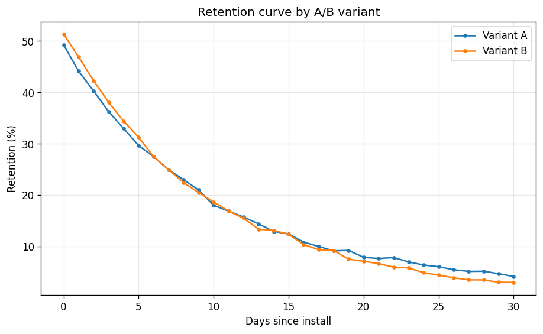
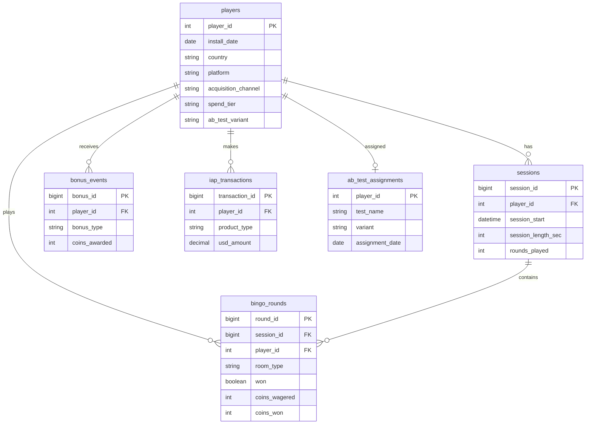
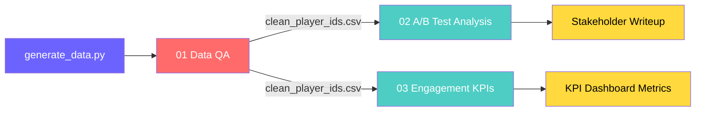
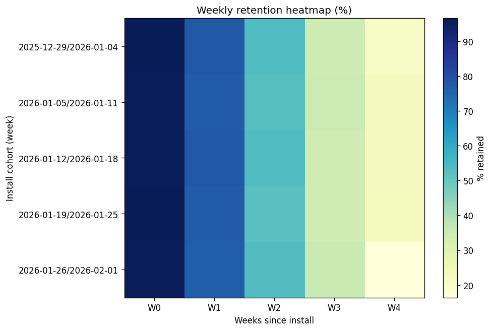

<div align="center">


<br/>


</div>

A portfolio project simulating end-to-end analytics for a live-service F2P
bingo-style mobile game: schema design, synthetic data generation, a full
A/B test analysis with proper statistical methodology, and a standard
engagement/monetization KPI suite.

**Built to mirror the day-to-day of a Data Analyst on a mobile game's live
games team** — the kind of analysis behind titles like Bingo Bash, Monopoly
GO, and similar top-grossing F2P titles.

---

## 🔑 Headline finding

An A/B test on the jackpot bonus wheel's payout structure (steady vs.
high-variance rewards) showed a statistically significant **Day-1
retention lift of +2.8pp** for the treatment group — which fully reversed
into a significant **Day-30 retention loss of −1.1pp** by the end of the
30-day observation window.

<div align="center">

| Day | Control (A) | Treatment (B) | Δ | p-value | Verdict |
|:---:|:---:|:---:|:---:|:---:|:---:|
| **D1** | 44.1% | 46.9% | 🟢 +2.78pp | 0.0003 | Looks like a win |
| **D7** | 25.0% | 25.0% | ⚪ ~0.00pp | 0.9995 | Converged |
| **D30** | 4.2% | 3.0% | 🔴 −1.14pp | 0.00007 | Significantly worse |

</div>

> 💡 **Evaluated on a typical one-week check-in, this test would have shipped.**
> The full 30-day window shows it shouldn't have.

📄 Full stakeholder readout: [`docs/stakeholder_writeup.md`](docs/stakeholder_writeup.md)

<div align="center">

</div>

---

## 📑 Table of contents

- [Project structure](#-project-structure)
- [Data model](#️-data-model)
- [What each notebook covers](#-what-each-notebook-covers)
- [Analysis workflow](#-analysis-workflow)
- [Running it locally](#-running-it-locally)
- [Stack](#️-stack)

---

## 📊 Project structure

```
bingo_analytics/
├── generate_data.py              # synthetic data generator (20K players, 60-day window)
├── sql/
│   └── schema.sql                # table definitions
├── data/                         # generated CSVs (gitignored — run generator locally)
│   └── sample_players.csv        # small sample for browsing without running the generator
├── notebooks/
│   ├── 01_data_exploration_and_qa.ipynb   # data audit, catches a real QA-account contamination issue
│   ├── 02_ab_test_analysis.ipynb          # SRM check, retention curves, significance tests, guardrails
│   └── 03_engagement_kpis.ipynb           # DAU/MAU, cohort retention, ARPU/ARPPU, economy health
├── docs/
│   └── stakeholder_writeup.md    # one-page non-technical readout
└── requirements.txt
```

## 🗂️ Data model



---

## 🔄 Analysis workflow



---

## 🔍 What each notebook covers

<details open>
<summary><b>📓 01 — Data Exploration & QA</b></summary>
<br/>

Standard first-pass audit: nulls, dtypes, ranges. Catches a real data
quality issue baked into this dataset — 25 internal QA/test accounts
generating bot-like session volume that would silently distort DAU and
engagement metrics if not filtered out before analysis.

**🚩 Issue found:** ~0.1% of players (internal QA accounts) generated
~2.7% of all sessions, with near-zero session durations — a bot-like
signature. Excluded via a saved `clean_player_ids.csv` that every
downstream notebook joins against.

</details>

<details>
<summary><b>📓 02 — A/B Test Analysis</b> (the core deliverable)</summary>
<br/>

- Sample Ratio Mismatch (SRM) check via chi-square goodness of fit
- Day-1 / Day-7 / Day-30 retention curves by variant
- Two-proportion z-tests with 95% confidence intervals at each checkpoint
- ARPU guardrail check to rule out a revenue trade-off
- A written recommendation and process takeaway for the team

</details>

<details>
<summary><b>📓 03 — Engagement & Monetization KPIs</b></summary>
<br/>

- DAU / MAU and stickiness ratio
- Weekly cohort retention heatmap
- ARPU and ARPPU by spend tier, payer conversion rate
- In-game economy health check (wager vs. payout ratio by room type)

<div align="center">

</div>

</details>

---

## 🚀 Running it locally

```bash
pip install -r requirements.txt
python generate_data.py          # generates data/*.csv (~85MB total, ~30 sec)
jupyter notebook notebooks/       # run 01 → 02 → 03, in order
```

---

## 🛠️ Stack

<div align="center">


</div>

Statistical methods: chi-square SRM testing, two-proportion z-tests,
confidence intervals, guardrail metric analysis.

<div align="center">
<br/>


</div>
